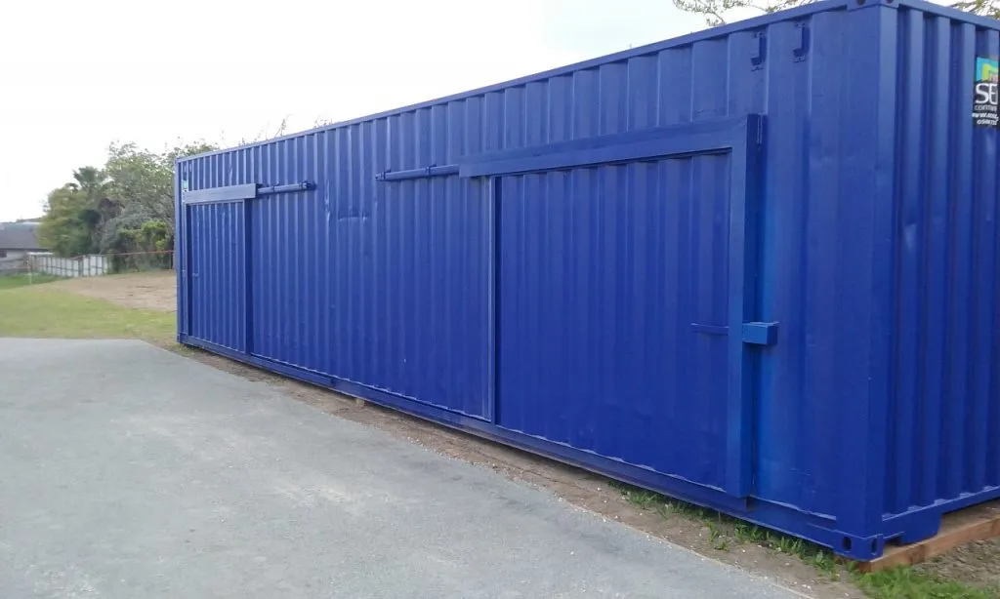
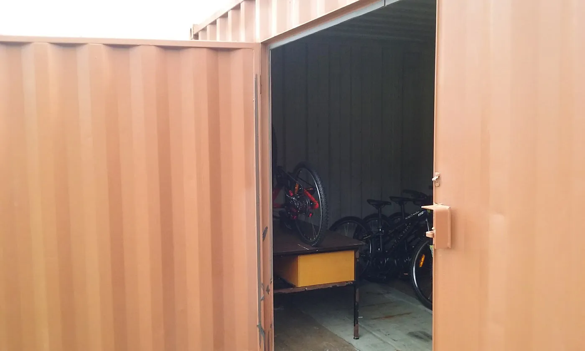
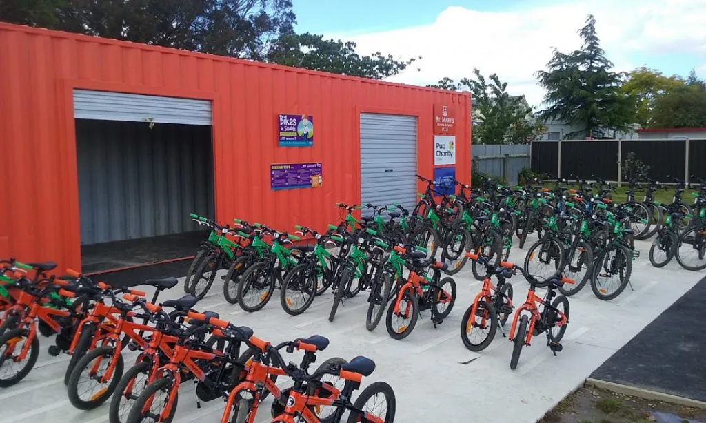
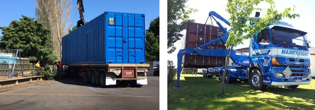
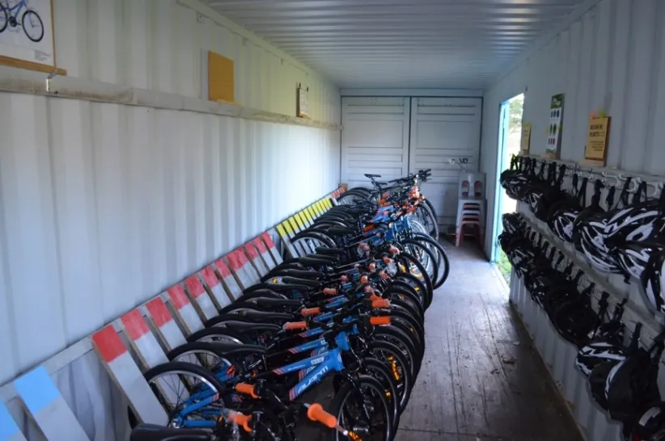
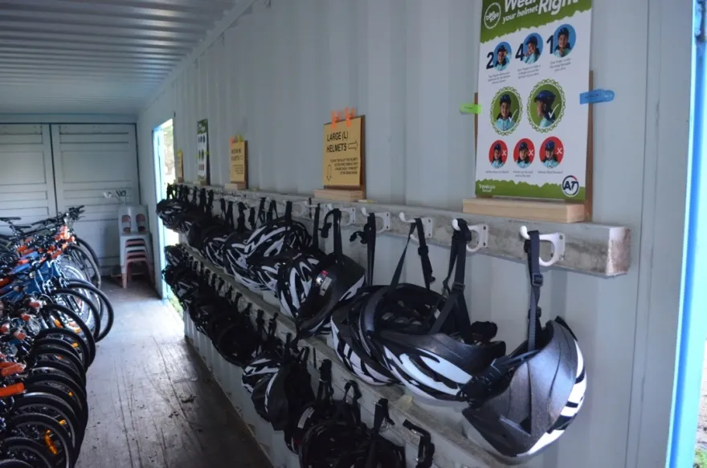

## Why secure storage matters

Bikes need to live somewhere safe, secure, and alarmed if you can manage it. The closer that spot is to the [tracks](/guide/bike-tracks), the more the bikes get ridden.

Some schools make do with an existing shed or unused classroom. Others go purpose-built. Either way, think carefully about location and layout before you commit. Easy access for teachers and kids, at exactly the time they need it, should drive every other decision.

## The shipping container option

Most schools end up with a converted 40-foot shipping container. It's usually exempt from needing a building permit, since it's not a permanent structure, but check with your council. A container can also be moved if your school's needs change.

A shipping container with a flat floor is better than a ribbed steel one because it makes wheeling bikes in and out much easier.

### What a converted container usually includes

- A 40-foot container
- Internal repaint, light grey
- External repaint, with rust protection where needed
- Two hinged swing doors, generally 2.0m high and 1.6m wide
- A welded padlock box on each door

Hinged doors are usually the most secure option and often cheaper than roller doors. A sliding door is a third option some schools choose.

Smaller fleets or trickier sites sometimes call for a 20-foot container rather than the full 40-foot.

## Security

Some schools add lighting, power outlets, and a connection to the school's existing alarm system, particularly if the container sits near a building. Wireless alarm systems and remote security cameras are affordable options worth considering.

A welded padlock box works with closed-shackle or standard padlocks, giving extra protection to the padlock itself. If you've gone with a roller door, a security gate fitted over the front makes a real difference.

## Where to put the container

If the container's sitting on grass, keep it slightly raised on railway sleepers so air can circulate underneath. A concrete pad for the container and one out front for daytime bike parking, with a ramp up to the door lip, makes for a much smoother daily routine.

A container truck is usually around 18 metres long. Make sure there's enough room to get it onto site, and that the truck can park parallel to where the container's going. If you're not sure, ask the trucking company to do a site visit first.

## Container dimensions

**Standard 40-foot**
W: 2.44m · H: 2.6m · L: 12.2m

**High Cube 40-Foot**
W: 2.44m · H: 2.9m · L: 12.2m

**Ground Footprint**
12.20m x 2.44m

## Approximate cost

A fully converted and painted 40-foot container with two doors typically costs $10,000 to $15,000 + GST, depending on supplier and location. See [Costs and funding](/guide/costs-and-funding) for the full budget.

## Fitting it out

What goes inside depends on the budget. Some suppliers offer a fit-out package ($1,000 to $3,000) with a steel bike rack, helmet hooks, and shelving.

Plenty of schools go the DIY route: upcycled wooden pallets make a solid bike rack, especially painted to colour-code where each size parks.

### Smart stacking saves space

Bikes and equipment that are stored smartly make everyone's lives easier and let students have more riding time. [Watch this video](https://www.youtube.com/watch?v=THpkAuj_BB0) explaining a clever stacking system that really does save space, reduce damage, and is easy for everyone to follow.

### Choosing a colour

Forest green is a popular choice for blending into the grounds, but most suppliers can match your school colours. Ask for a colour chart. Some schools turn the painting into a student art project.

## Storage ideas worth borrowing

- Hang [helmets](/guide/helmets) on the opposite wall from the bikes, so there's no bottleneck at the door
- Store helmets in flexible storage bins, sorted by size (approximately $6 each from Bunnings or Mitre 10). These bins should be the first items removed when setting up and the last items packed away when closing the container, so helmets are readily accessible when needed
- Group same-sized bikes together
- Number bikes and use a matching asset sticker system
- Top-and-tail bikes on the floor to fit more in
- A small electric air compressor saves time pumping tyres
- A tripod-style repair stand helps with [maintenance](/guide/maintenance)
- Closed-shackle padlocks with lockboxes on hinged doors
- Connect to the school alarm system if you can
- Lighting and a small tool bench area go a long way

## Getting quotes from local suppliers

Start with the suppliers below, then get quotes from local suppliers as well. Prices can vary.
