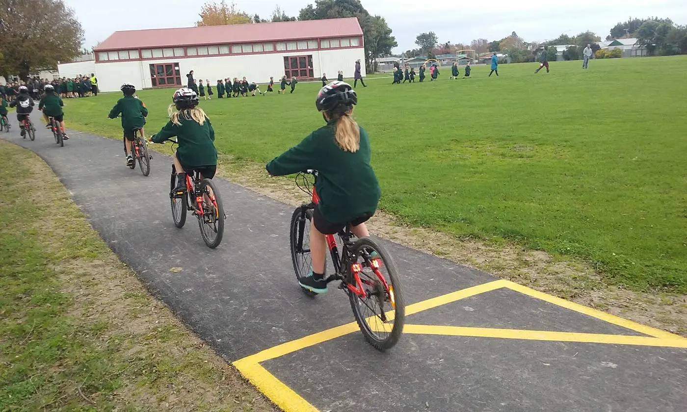
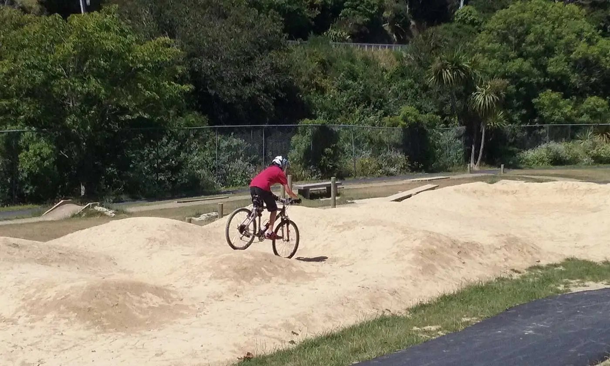
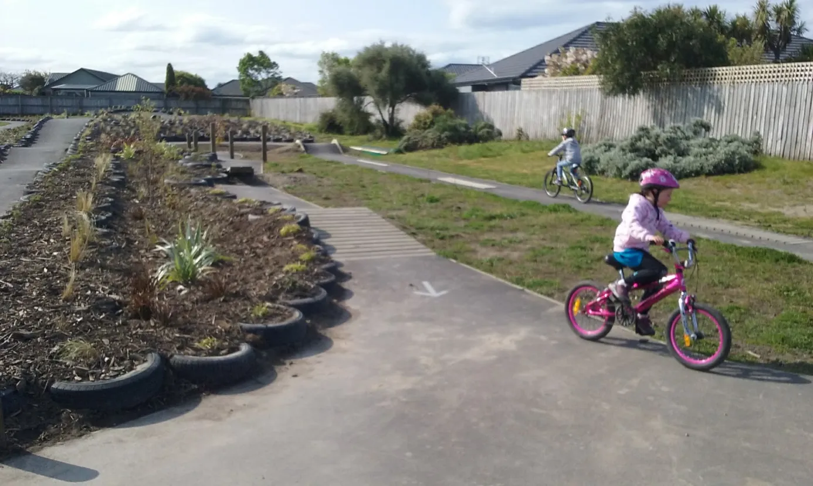

## The riding track

This is where most of the riding happens. Schools usually run it around the outside of the playing fields, so it doesn't cut across rugby and soccer. Some loop partway around and double back to fit the available space.

Fifty or more kids can ride at once on a well-built riding track. Beyond biking, schools use the same track for walking, running, school triathlons (if there's a pool), and scooters if it's surfaced in asphalt.

### Riding track: Building in asphalt or concrete

- 2 metres wide
- 200 to 700+ metres long
- Basecourse: GAP 40, 75 to 100mm deep, 2.5m wide
- Surfacing: asphalt or concrete, 25 to 40mm deep, 2.0m wide
- Gentle curves, not straight lines: more fun to ride, and they naturally slow things down
- Depth of basecourse can vary; get local advice
- A 300m track like this typically costs around $85,000, though costs vary significantly by length and region

## The pump track

Kids don't pedal on a pump track. They pump their bikes through the rollers to keep moving, a bit like working a swing. It's the track kids love most, and it burns more energy than the others.

Limit it to six riders at a time. Loop your track designer in with your bike supplier before building starts; different bikes have different centres of gravity, and having a kid's bike on-site during construction helps the design suit what you'll actually be riding.

- Mostly dirt, with limestone along the top
- Not a jump track
- Around 20m by 20m, though some schools have made it work in as little as 5m by 15m
- A BMX club or professional track builder is worth getting in for design and construction
- Costs run $8,000 to $15,000, depending on size and region

## The skills track

A limestone track with a series of obstacles: skinnies, a slalom, a see-saw, and similar. It's the slowest of the three to ride, on purpose: it asks for concentration rather than speed, and it's particularly good for hand-eye coordination. Like the pump track, keep it to six riders at a time.

- Around 10m by 30m
- Costs run $6,000 to $10,000, depending on size, obstacle count, and region
- Get an experienced provider to build it

[How to build a Skills Track (PDF)](/downloads/how-to-build-a-skills-track.pdf)

A few schools have built their skills track with asphalt as this reduces ongoing maintenance needed.

