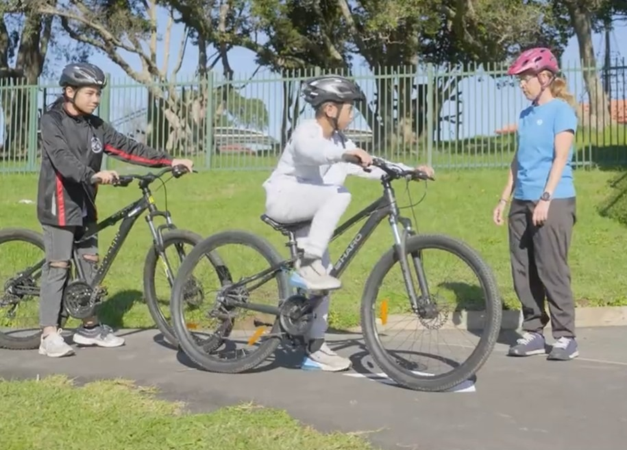

## Book cycle skills training early

Book introductory cycle skills training to run from the very first day your tracks open. A good trainer will help fit [helmets](/guide/helmets), match kids to the right size [bike](/guide/bikes), walk everyone through how each [track](/guide/bike-tracks) works, and run some games to make the first sessions fun rather than overwhelming.

Get in touch with your local provider early (usually your council, a Regional Sports Trust, or local Police) so training's locked in before the tracks are.

Auckland Transport funds cycle skills training for every Auckland Bikes in Schools project. Councils in Wellington, Palmerston North, and Christchurch back their local projects the same way.

## BikeReady: the national cycle skills programme

[BikeReady](https://www.bikeready.govt.nz/) is New Zealand's national cycle skills training programme. It's free, age-appropriate, and delivered by qualified instructors through local councils and community providers.

Read more about [BikeReady cycle skills training](https://www.bikeready.govt.nz/schools/cycle-skills-training-whats-involved/).

## Classroom resources

For games, activity cards, and curriculum links to use alongside skills sessions, see our [Resources](/resources) page.
